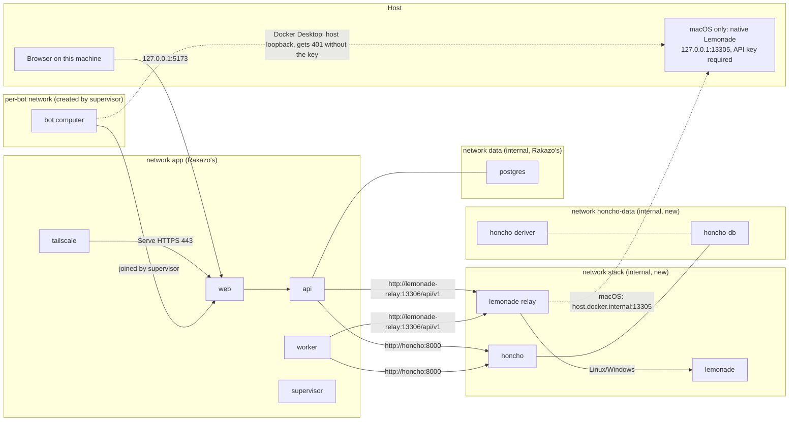

# PROTOTYPE, throwaway: rakazo-stack compose layout

**Question** ("What does the stack's compose layout look like?", kamui/rakazo-stack#10): which services run, on which networks, what reaches the host, how Rakazo addresses voice and memory, and how bot computers are kept away from them, on Linux, Windows (WSL2) and macOS.

Files:

- `rakazo.v0.4.0.images.yml`: Rakazo's own compose file, byte-for-byte from `infra/compose/docker-compose.images.yml` at tag v0.4.0.
- `compose.stack.yaml`: rakazo-stack's layer on top of it.
- `relay/lang-code-relay.ts`: the `lang_code` relay, now also adding Lemonade's API key.
- `tailscale-serve.json`, `honcho/init.sql`: mounted config.

Services are named after the app they run (`lemonade-relay` is the relay in front of Lemonade). Validated with `docker compose config` for every profile combination (dummy values). Booted end to end on Windows/WSL2 in [Boot the drafted compose layout end to end](https://github.com/kamui/rakazo-stack/issues/24).

## Shape

One compose project. Setup writes `COMPOSE_FILE=rakazo.v0.4.0.images.yml:compose.stack.yaml` and `COMPOSE_PROFILES` to `.env`, so plain `docker compose up -d` works.

| Profile | Services | When |
|---|---|---|
| (always) | Rakazo's `postgres`, `migrate`, `supervisor`, `api`, `worker`, `web`; `lemonade-relay` | always |
| `lemonade` | `lemonade` (upstream image + ffmpeg, built locally) | Linux, Windows. On macOS Lemonade runs natively. |
| `honcho` | `honcho`, `honcho-deriver`, `honcho-db` (pgvector, Postgres 18); no Redis (`CACHE_ENABLED=false`) | when a model provider key is given |
| `tailscale` | `tailscale` (userspace, Serve → `http://web:5173`) | when Tailscale access is chosen |

`egress` (a plain network, not drawn) gives Lemonade (model downloads), Honcho (model APIs) and the relay (macOS host) outbound access; `stack` and `honcho-data` are internal.

## Rakazo settings setup writes (all via `.env`; upstream's file already passes them through)

- `MCP_ALLOW_PRIVATE_ENDPOINT=true`, `RAKAZO_OPENAI_COMPAT_PRIVATE_HOSTS=lemonade-relay`
- Owner's voice: Self-hosted, Server URL `http://lemonade-relay:13306/api/v1`
- Default Space memory: `http://honcho:8000` + Honcho admin JWT
- New generated secrets: `LEMONADE_API_KEY`, `HONCHO_DB_PASSWORD`, `HONCHO_AUTH_JWT_SECRET` (+ admin JWT)
- macOS: `LEMONADE_UPSTREAM=http://host.docker.internal:13305`

## Setup steps the layout relies on

- After Lemonade starts: `lemonade config set whispercpp.args=--convert` (browser WebM/MP4 needs it; `cpu_args` is ignored because backend `auto` picks vulkan), then pull and load `kokoro-v1` and `Whisper-Large-v3-Turbo` through the relay. Safe to repeat on re-runs.
- Rakazo's API port is not published (`ports: !reset []`); setup and browsers use the web port, which proxies `/api` and `/rpc`.
- Honcho's tokenizer files are cached in the `honcho-tiktoken` volume; embeddings are hosted through the model provider.

## Who can reach what

| From | Lemonade / relay / Honcho / databases | Why |
|---|---|---|
| Rakazo `api`, `worker` | yes, by service name | on `stack` |
| Rakazo `web` | no | only on `app` |
| Bot computer, Linux | no | own per-bot bridge (joined only by `supervisor` and `web`); nothing of ours is published to the host |
| Bot computer, Windows | no | same; Docker Desktop leaves computer egress open, but there is nothing on host loopback to reach except Rakazo's own web/API ports |
| Bot computer, macOS | can open a connection to native Lemonade, which refuses it without the API key; nothing else | Docker Desktop lets containers reach host loopback; only the relay holds the key |

Sources: Rakazo v0.4.0 `infra/sandboxes/supervisor/src/computer-spec.ts` (per-bot bridge, no extra hosts), `index.ts` (isolated screen network joins supervisor + `web`), `packages/adapters/src/openai-compatible-url.ts` (private hosts list), `apps/api/src/memory-provider-config.ts` (private-resolving hosts with the flag); Lemonade `LEMONADE_API_KEY` secures all endpoints; Honcho v3.5.0 `docker-compose.yml.example`, `src/config.py` (cache optional).

## Not checked yet (needs a boot)

- Honcho v3.5.0 migrations and a memory round trip on pgvector Postgres 18 (upstream tests only Postgres 15).
- Relay + key end to end (voice sample, transcription).
- Tailscale container in userspace mode under Docker Desktop; Serve preserves the Host header (source says yes).
- A bot computer really can't reach `lemonade-relay`, `honcho`, `honcho-db` (and on macOS gets 401 from Lemonade).
